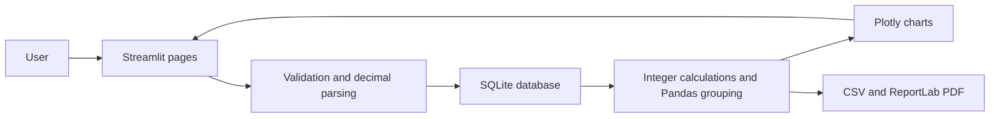
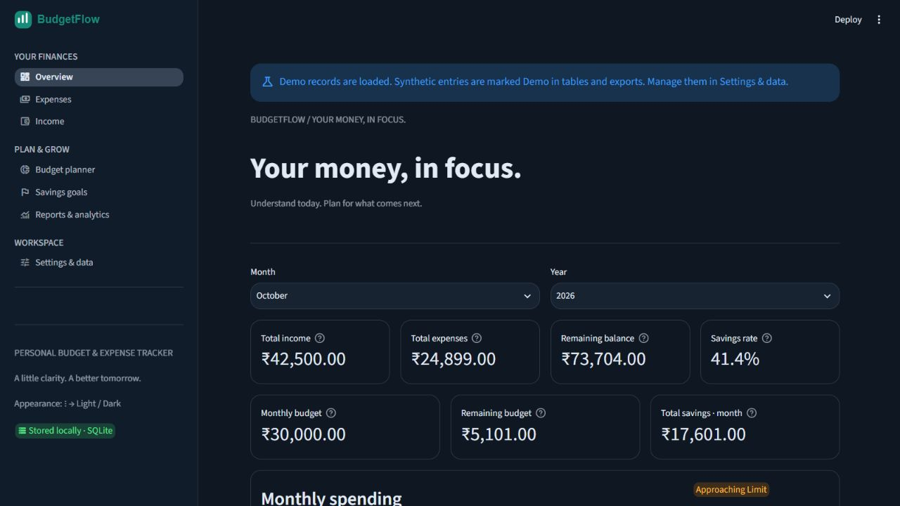
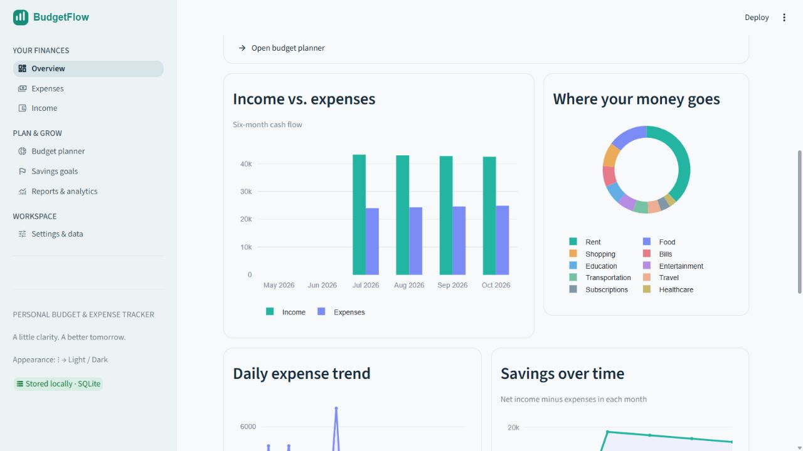

# BudgetFlow

## Personal Budget & Expense Tracker

A Python college project that turns everyday financial entries into a clear, interactive picture of income, spending, budgets, and savings goals. The application runs locally with Streamlit and stores its data permanently in SQLite.

## Problem statement

Daily purchases, irregular income, and scattered notes make it difficult to understand where money goes. BudgetFlow brings those records into one place, calculates monthly cash flow, compares spending with a plan, and produces useful reports.

## Objectives

- Record, edit, search, filter, and delete income and expenses.
- Track monthly and category spending limits.
- Calculate balances, net savings, and savings rates accurately.
- Track contributions toward personal goals without double counting.
- Explain spending patterns with interactive charts and rule-based insights.
- Import CSV records and export transactions, category summaries, and PDF reports.

## Technology stack

| Technology | Purpose |
| --- | --- |
| Python 3.11+ | Application logic and validation |
| Streamlit 1.65+ | Forms, navigation, tables, themes, and notifications |
| SQLite / `sqlite3` | Permanent, local storage |
| Pandas | Grouping and filling missing dates for analytics |
| Plotly | Interactive charts with tooltips and zoom |
| ReportLab | Paginated PDF reports |
| `csv` and `decimal` | CSV interoperability and exact decimal input |
| pytest, pypdf | Automated checks and PDF verification; development only |

The project uses open-source libraries and bundled DejaVu fonts. No cloud infrastructure, subscriptions, API keys, JavaScript framework, or Node.js runtime is required to run it.

## Installation and first run

Open a terminal in this folder. Python 3.11 or newer must be installed.

```powershell
cd "D:\University Work\Python Programming\BudgetFlow"
python -m venv .venv
.\.venv\Scripts\python.exe -m pip install -r requirements.txt
.\.venv\Scripts\python.exe -m streamlit run app.py
```

Open the local URL printed in the terminal, normally **http://localhost:8501**. Keep that terminal running; press **Ctrl+C** to stop the app. The first visit creates `data/budgetflow.db` automatically. The initial database is empty.

If you prefer activating the virtual environment:

```powershell
.\.venv\Scripts\Activate.ps1
pip install -r requirements.txt
streamlit run app.py
```

If PowerShell blocks activation, use the first set of commands; activation is optional. On macOS/Linux, use `python3 -m venv .venv`, then `.venv/bin/python -m pip install -r requirements.txt` and `.venv/bin/python -m streamlit run app.py`.

## A five-minute demonstration

1. Open **Settings & data**, then choose **Load sample demo data**. It adds four months of clearly labeled synthetic records and three sample goals.
2. Open **Overview** to explore cards, charts, budget utilization, recent transactions, and calculated insights. Change month/year.
3. Open **Expenses** or **Income**. Add a record, use **Transaction history** filters, then edit it in **Edit & delete**. Deletion requires confirmation.
4. Set an overall monthly budget and category allocations in **Budget planner**. Their sum cannot exceed the overall limit. Zero removes a category limit.
5. Create a savings goal and record a contribution. Once its target is reached, **Mark completed** becomes available.
6. In **Reports & analytics**, select a date range and interval. Download CSV summaries or prepare and download a PDF.
7. Switch appearance using the **⋮** menu, then **Light** or **Dark**. Both themes use supported Streamlit configuration.
8. Remove demo records in **Settings & data** when finished. Only records still tagged as demo are removed. Edited demo records become personal; goals with personal contributions are preserved.

All loaded demo entries are marked in transaction tables and CSV exports. Reports explicitly identify the number of synthetic entries. An ongoing calendar month's comparison with a previous full month may be incomplete.

## Key features

- Seven overview metrics, six-month income/expense comparisons, category donut chart, daily expense trend, and savings trend.
- Exact amount entry; 11 expense categories, 8 income sources, and 5 payment methods.
- Interactive sortable transaction tables and explicit amount/date/category/search filters.
- Monthly budgets with category progress, remaining amounts, and clear warning thresholds.
- Savings goals with contribution history, correction, editing, completion/reopening, and confirmed deletion.
- Daily, Monday-based weekly, monthly, and yearly reports with payment-method distribution.
- UTF-8 CSV import with preview, validation, and atomic insertion; formula-safe CSV export.
- Printable PDF reports with currency codes, actual period totals, category summaries, a complete ledger, repeated table headings, and page numbers.
- Persistent display currency preference: INR (default), USD, EUR, or GBP.
- Helpful empty states, notifications, error messages, and safe removal of tagged demo data.

## Architecture and project structure

```text
BudgetFlow/
├── app.py                     # Streamlit entry point and navigation
├── database.py                # SQLite schema and validated CRUD
├── requirements.txt           # Application dependencies
├── requirements-dev.txt       # Test dependencies
├── requirements-lock.txt      # Exact verified environment snapshot
├── pytest.ini
├── README.md
├── PROJECT_EXPLANATION.md      # Simple explanations and viva Q&A
├── TESTING.md                  # Executed checks and practical limits
├── .gitignore
├── .streamlit/
│   └── config.toml             # Supported light and dark themes
├── assets/
│   ├── logo.svg
│   └── fonts/
│       ├── DejaVuSans.ttf
│       ├── DejaVuSans-Bold.ttf
│       └── LICENSE_DEJAVU.txt
├── data/
│   ├── .gitkeep
│   └── budgetflow.db           # Created automatically; ignored by Git
├── pages/
│   ├── __init__.py
│   ├── dashboard.py
│   ├── transactions.py        # Shared income/expense workflow
│   ├── expenses.py
│   ├── income.py
│   ├── budgets.py
│   ├── savings.py
│   ├── reports.py
│   └── settings.py
├── utils/
│   ├── __init__.py
│   ├── calculations.py
│   ├── validators.py
│   ├── charts.py
│   ├── exports.py
│   └── ui.py
├── tests/
│   ├── conftest.py
│   ├── test_calculations.py
│   ├── test_database.py
│   ├── test_exports.py
│   └── test_ui.py
└── docs/
    └── screenshots/            # Verified application screenshots
```

`pages/` collects input and displays results. `database.py` validates and persists changes. `utils/calculations.py` handles finance independently of the interface. Plotly uses decimal values only to draw charts; authoritative amounts and totals remain integers.



Navigation uses `st.Page` and `st.navigation`, with callable render functions. Forms, metric cards, containers, tables, and theme configuration use public Streamlit APIs; the UI does not depend on internal HTML or CSS selectors.

## Database description

| Table | Stores | Important relationship |
| --- | --- | --- |
| `transactions` | Type, amount in paise, date, category, description, payment method, demo tag | Each record has a unique integer ID |
| `budgets` | Month, category or `Overall`, amount in paise, demo tag | Unique `(month, category)` |
| `savings_goals` | Name, target in paise, target date, completion state, demo tag | One goal has many contributions |
| `goal_contributions` | Goal ID, amount in paise, date, note, demo tag | Foreign key; deleting a goal cascades to contributions |
| `settings` | Persistent key/value preferences and demo-load marker | Primary key on setting name |

Connections enable foreign keys, use a timeout, and close after each operation. WAL mode improves local read/write behavior. Parameterized SQL keeps user input separate from executable queries. Imports, budget replacement, contribution recording, and demo changes use transactions.

## Definitions used by the dashboard

- **Total income / expenses:** sums in the selected calendar month.
- **Remaining balance:** all recorded income minus all recorded expenses through the selected month's end. Includes any future-dated entries within that period; no bank connection or opening balance is assumed.
- **Monthly budget:** the `Overall` limit. Category allocations are parts of it and are never added again to calculate the overall limit.
- **Remaining budget:** overall limit minus that month's expenses. Negative means overspent; no plan displays “Not set” or a dash.
- **Total savings · month:** that month's income minus expenses; it can be negative.
- **Savings rate:** monthly net savings ÷ income × 100. Zero income displays a dash instead of dividing by zero.
- **Goal contributions:** separate allocations. They neither create income nor subtract expenses and can be recorded independently of ledger balance. The application cannot verify that cash has actually been set aside.

Budget labels: below 75% **Within Budget**, 75% to below 100% **Approaching Limit**, and 100% or above **Budget Exceeded**. Progress bars cap at 100%, but numerical labels and negative remaining amounts show actual overspending.

## CSV format

```csv
kind,amount,category,transaction_date,description,payment_method
expense,120.50,Food,2026-10-12,Lunch,UPI
income,5000.00,Allowance,2026-10-01,Monthly allowance,Bank Transfer
```

Amounts use a decimal point and no thousands separators. Dates use `YYYY-MM-DD`. Category and payment names must match those in the app. Files exported by BudgetFlow can be imported; extra `source` metadata is informational, and imported rows become personal records. Imports append data and do not deduplicate across browser sessions. A warning and confirmation appear before import.

CSV text that could become a spreadsheet formula is prefixed with an apostrophe. BudgetFlow restores its safety prefix on descriptions when importing its own exports. PDF reports display ISO currency codes to avoid ambiguous symbols; CSV amounts are currency-neutral decimal text.

## Adding your salary and expenses

Use **Add salary or income** or **Add an expense** on Overview. For salary, the income form defaults to **Salary** and **Bank Transfer**. Enter the received date and amount, add a description if useful, and select **Add income**. Expense entries have their own date, amount, category, and payment method. Saved personal entries remain available after a restart.

If you want totals to reflect only your own entries, remove the labeled demo records through **Settings & data** first. That confirmed action preserves personal transactions.

## Local credentials

BudgetFlow does not require, load, or display API keys. Local `.env` files and Streamlit `secrets.toml` files are excluded from Git by `.gitignore`; this prevents adding them as new tracked files but does not encrypt them or remove previously committed copies. Keep actual credentials out of Python source, transaction descriptions, screenshots, and exports.

## Testing

```powershell
.\.venv\Scripts\python.exe -m pip install -r requirements-dev.txt
.\.venv\Scripts\python.exe -m pytest -q
.\.venv\Scripts\python.exe -m pip check
```

Tests use temporary SQLite databases and do not change your personal ledger. They cover exact arithmetic, validation, CRUD, month boundaries, restart persistence, atomic imports, budget thresholds, goals and cascading deletion, demo preservation, CSV round-trips, PDF contents/pagination, and Streamlit forms and empty/demo page execution. See `TESTING.md` for the actual verification results.

## Application screenshots

The screenshots in `docs/screenshots/` are captured from the running application. Demo views use clearly labeled synthetic data. See `TESTING.md` for the scope of visual review.





## Backup and troubleshooting

- **Back up everything:** stop the Streamlit server, then copy `data/budgetflow.db` to a safe location. CSV export only backs up transactions; it does not include budgets, goals, or settings.
- **Separate ledger:** optionally set `BUDGETFLOW_DB` to another SQLite file before launching. The default is always relative to the project, not the terminal's working directory.
- **Port already in use:** append `--server.port 8502` to the run command.
- **Missing dependency:** run installation through the same `.venv\Scripts\python.exe` used to launch Streamlit.
- **Invalid CSV:** read the row-specific error. No part of an invalid import is saved.
- **Database error:** make sure the data directory is writable. Avoid editing the database with another program while saving records.
- **Offline use:** once dependencies are installed, application data and processing stay local. Browser-provided font/icon resources may depend on browser caches.

## Limitations and future scope

This is a single-user local application without authentication, encryption, bank integration, or multi-currency conversion. Currency selection relabels values only. Charts and displayed percentages use floating point, while monetary calculations use integer paise. Long PDF ledgers can take time to prepare. DejaVu supports many scripts, but full shaping for every writing system and color emoji is not guaranteed. CSV retains the original Unicode text.

Potential extensions include recurring transactions, account balances/opening balances, recurring budget templates, encrypted backups, user authentication, and receipt attachments. These are future ideas, not active buttons in the app.

## Conclusion

BudgetFlow demonstrates Python functions, classes, collections, validation, file handling, database CRUD, modular design, and practical data visualization in one usable project. Its calculations can be explained and tested independently of its graphical interface.

## References

- [Streamlit navigation](https://docs.streamlit.io/develop/concepts/multipage-apps/page-and-navigation)
- [Streamlit theme configuration](https://docs.streamlit.io/develop/concepts/configuration/theming)
- [Python SQLite documentation](https://docs.python.org/3.11/library/sqlite3.html)
- [Python Decimal documentation](https://docs.python.org/3.11/library/decimal.html)
- [Plotly Python documentation](https://plotly.com/python/)
- [ReportLab](https://www.reportlab.com/opensource/)
- [DejaVu fonts](https://dejavu-fonts.github.io/)
